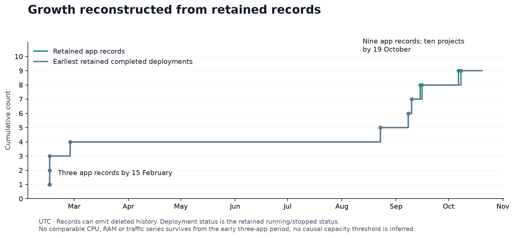
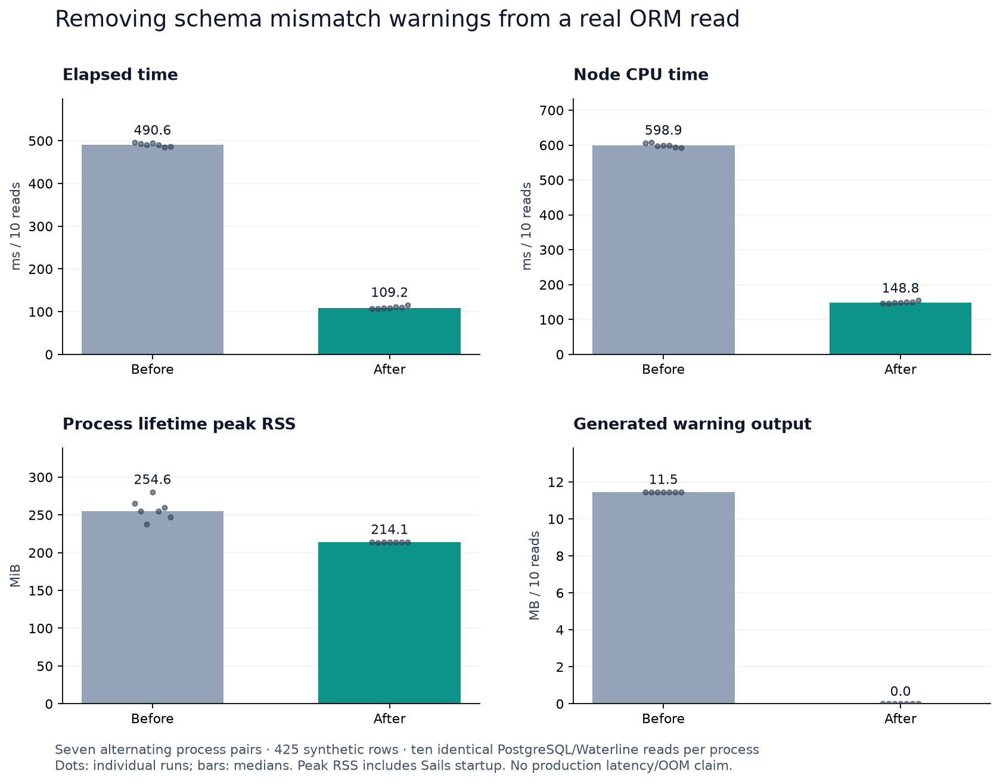
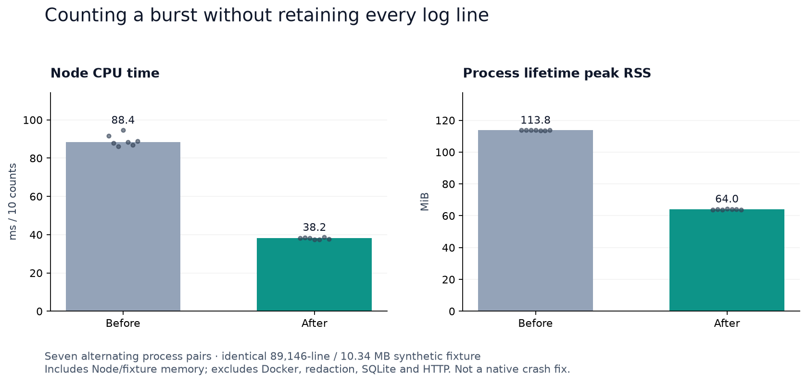

# Fleet performance investigation — 20 October 2026

Tracking: [umbrella #833](https://github.com/sailscastshq/slipway/issues/833); [native crash #807](https://github.com/sailscastshq/slipway/issues/807). This packet distinguishes measured fixes from unresolved production failures. No claim is made that all performance or memory issues are solved.

## What is established

Slipway **v0.0.113 still crashed with SIGBUS** at **11:19:36.514 UTC**, exit 135 after 910 seconds. A passive observation saw its restart count increase from zero to one. The sampled kernel window had no OOM or I/O error. The time is close to the third five-minute collector/maintenance interval; a native fault address or stack is still needed before attributing it. The duplicate Lookout console-collector repair shipped earlier in #831, but this recurrence disproves an assertion that v0.0.113 resolves the crash.

Sailsconf had separate memory-cgroup kills at 08:26 and 08:29 while limited to 512 MiB. Its user-raised 1 GiB live limit is separate from code changes. FlossAfrica had exact-cgroup OOM events at 09:58:45 and 10:59:01 with a 512 MiB limit. A current `OOMKilled=false` and a healthy response do not erase those events. Chieflevite's cumulative restart count of 186 has no cause established by this inventory.

FlossAfrica has a reproduced schema warning flood. Its PostgreSQL model expects a zero-default numeric refresh deadline and false-default eligibility; the actual correctly typed columns are nullable and have no database defaults. Read-only counts found 406 null deadlines, 404 null eligibility values and 21 existing verified eligibility values among 425 projects. Stored metadata records an 89,146-line five-minute log burst. Fixed-prefix host-only counters locate null-property warnings in Waterline; no raw logs or project records were exported. The separately prepared manual migration preserves verified eligibility and existing non-null deadlines/observations. An original `ADD COLUMN IF NOT EXISTS` cannot install constraints onto an already-existing nullable column. The historical creator of that schema drift is not established.

## Capacity baseline

At 11:11 UTC the host exposed 8 logical CPUs, 15.24 GiB RAM, approximately 9.04 GiB available, no swap and no sustained memory pressure in the instant pressure samples. The preceding 11:07 checkpoint had load 0.85/1.82/1.97 and approximately 195 GiB available filesystem space. These are snapshots, not peak-capacity results.

There were 10 projects, 9 running app records and 41 running containers: 11 app generations, 18 database/cache services, 10 routing containers, Slipway and its proxy. Two app generations are not selected by current App records. Their combined current cgroup charge was approximately 0.92 GiB, including file/cache pages; old Hagfish also had two console workers in the process snapshot. They have restart-unless-stopped policies. No containers were stopped or deleted.

| Configured app   |   Limit | Main Node RSS / PSS at snapshot |                                         Recent one-hour Docker-memory maximum |
| ---------------- | ------: | ------------------------------: | ----------------------------------------------------------------------------: |
| Hagfish          |   2 GiB |                   509 / 462 MiB |                                                                       773 MiB |
| African Engineer | 1.5 GiB |                   458 / 411 MiB |                                                                       794 MiB |
| Sailscasts       | 1.5 GiB |                   279 / 237 MiB |                                                                       286 MiB |
| Tembo AI         | 512 MiB |                   277 / 230 MiB |                                                                       259 MiB |
| Pairlore         | 512 MiB |                   209 / 166 MiB |                                                                       188 MiB |
| Depth            | 512 MiB |                   235 / 189 MiB |                                                                       227 MiB |
| Sailsconf        |   1 GiB |                   407 / 360 MiB | 517 MiB for the then-new current generation; older generation reached 595 MiB |
| FlossAfrica      | 512 MiB |                   243 / 195 MiB |                       387 MiB; this sampled maximum missed the known OOM peak |
| Chieflevite      |   1 GiB |                   470 / 422 MiB |                                                                       451 MiB |

RSS includes shared pages; PSS apportions them. Neither should be added to cgroup usage. Main-process numbers omit child workers and cache; cgroup peak/event counters reset on restart and sampling can miss brief peaks. Current finite limits across all containers already total **16.375 GiB**, above physical RAM, before unlimited Slipway/proxy. Limits are ceilings, not reserved consumption or a simultaneous admission budget.

Slipway itself had main Node RSS/PSS approximately 918/870 MiB. Its 3.38 GiB cgroup charge included approximately 827 MiB anonymous memory and 2.52 GiB file pages, including about 2.38 GiB inactive file. Docker's cache-subtracted display, full cgroup charge and process RSS are different measures. The observability database was about 3.41 GiB on disk. These observations do not prove a heap leak. The SQLite adapter also permits a 256 MiB page cache per connection by default; this is a capacity lead, not a tested configuration change in this PR.

For this Quest-heavy fleet, **1 GiB is a reasonable provisional new-app default**, with overrides and a worker/build concurrency budget. The actual new-app default remains 512 MiB in `api/models/App.js`; this work does not change it. Changing the model default would not update existing app rows. The settings API separately attempts a live `docker update` without restart, saves desired values even if application fails, and applies them on subsequent deployment. Production resource changes require their own approval and verification.

Reserve headroom for the OS, unlimited platform, database/cache services, one approved build/deploy peak and overlapping web/Quest/Bridge workers. Size against observed simultaneous peak working set plus headroom, not summed RSS or an arbitrary app-count multiplier. FlossAfrica remains the urgent confirmed 512 MiB risk. No blanket capacity change is implied by the quiet snapshot.

## Growth and retained history

[Growth data](growth.csv) reconstructs retained App creation dates and the earliest retained deployment currently marked running/stopped. Three app records existed by 15 February, a fourth by 26 February, a fifth by 23 August, and nine by 6 October. The tenth project existed by 19 October and had no configured App in the inspected inventory. Record creation is not continuous availability, and deleted records may be absent. Two extra app generations make app-container count eleven rather than nine.

Retained container metrics begin **19 October 11:10 UTC** and request spans begin **13 October 09:31 UTC**. There is no comparable CPU/RAM/traffic series from the initial three-app period. Therefore the article cannot claim a measured threshold at which ten apps exhausted the host. Deployment growth, host headroom, per-container OOM and native failure are separate evidence tracks.

In the bounded recent request sample, all observed rows were server spans and sampled 5xx counts were zero. Per-app counts ranged from one to about 444; these are sampled spans, not complete request rates or an availability guarantee. Pairlore's p95 was 136 ms, with p99 around 105 seconds and a maximum around 39 minutes: long-lived responses/stream lifetimes need classification before treating this as ordinary request latency. Sailsconf p95/p99 were 210/607 ms; FlossAfrica 1007/1107 ms from only 33 spans. No production load was generated and no aggregate throughput claim is made.

## Measured local changes

A real local PostgreSQL/Waterline reproduction uses 425 synthetic projects with the same null-count pattern, not copied production records. Seven alternating process pairs perform one warmup and ten reads each. After the proposed schema repair, warnings fall from 8,100 / 11.46 MB per ten reads to zero. Median elapsed is 490.6 → 109.2 ms, Node CPU 598.9 → 148.8 ms, process lifetime peak RSS 254.6 → 214.1 MiB. Startup is included in the RSS maximum. See [raw pairs](floss-warning-raw.json). Production OOM reduction remains unmeasured until a separately approved migration and observation.

The Slipway code change replaces `split/filter` line counting with incremental counting, avoiding retention of a substring for every line. Docker command, buffer/time limits, returned text and nonblank-line semantics are unchanged. The 89,146-line fixture has synthetic widths, not copied log content. At 116 bytes/line, seven matched alternating process pairs (ten counts each) give median CPU 88.37 → 38.18 ms and process peak RSS 113.8 → 64.0 MiB. This is a roughly 57% CPU / 44% RSS improvement for **the counting stage**, excluding Docker, redaction, persistence and HTTP. The small 100-line fixture is not improved: roughly 0.10 → 0.13 ms total across ten counts, which is negligible in context but retained in [all raw samples](log-lines-raw.json). Neither benchmark proves SIGBUS fixed.

Runtime for both matched benchmarks: Node v24.14.1, macOS ARM64; PostgreSQL 16.13 for the warning benchmark. Production uses Linux/x64 Node v22.23.3, so absolute timings are not transferable. Source test coverage proves blank/Unicode-whitespace/final-line behavior, an 89,146-line count and existing resource-alert incident/delivery/idempotency contracts. No notification behavior is changed.

Reproduce counting with `node tools/benchmark-log-lines.cjs`. The FlossAfrica repair PR contains its guarded PostgreSQL benchmark. Replot with Python and matplotlib using `python3 tools/plot-performance-evidence.py`; checked-in raw runs generate the graphs without network access.

## Old generations and native investigation boundaries

The two older app containers were created on 7 October. Their `731` suffix is not reliable deployment identity: retained deployment 731 belongs to a failed different-app deployment. Current deployment jobs preserve explicit candidate/previous names and recent cutovers show those names, but that does not establish the old containers' creation/retention cause. Current normal cleanup treats a previous-container stop failure as nonfatal, which is a possible retention path, not proven history for these two containers. Automatic name-based sweeping would risk the wrong resource and duplicated/stopped business work. A retirement proposal needs explicit current-route, recovery, scheduler and storage ownership evidence before approval.

Native SIGBUS still lacks a retained fault address/backtrace. Initial local matching-native-runtime synthetic WAL/redaction concurrency checks did not reproduce it in 40 short cycles; that is not a representative soak or a fault-module exclusion. A Linux/x64 image runs under emulation on this ARM Mac, introducing a further limitation. No production core/heap dump or debugger was used. If bounded local reproduction cannot produce a stack, the next step is separately approved, tightly scoped native diagnostic capture or an approved collector-isolation experiment. A debugger can pause the process and a core can contain secrets; no such capture/export is authorized by this packet.

## Exit criteria and rollout gates

Local gates: exact revision, reproducible matched workloads, raw runs, passing targeted regression checks, preservation of existing verified eligibility and transactional rollback. No private evidence is included in public benchmark files.

Production gates after separately approved changes: record effective limits/revisions, compare request mix and sampling coverage, verify warning/default/null counts and existing verified rows, then observe at least **24 hours** of representative traffic and scheduled-worker cycles. Require no new native faults/OOM/unexplained restarts, no duplicated notifications, acceptable p95/p99 for comparable ordinary requests, stable warmed memory/headroom and no unbounded growth. Extend observation if peak jobs/builds were absent. A reset restart counter or a single healthy response cannot close a crash issue.

Do not merge broad optimizations, deploy, change live limits, apply the migration, stop old generations or publish the blog without separate approval. The umbrella and native-crash issue remain open.

### Local native probe details

`native-probe.txt` records a successful 40-cycle probe (21.7 seconds of measured loop time, about 227 MiB maximum sampled RSS) using cached published image v0.0.103, whose Node v22.23.3 / better-sqlite3 12.11.1 / sails-sqlite 0.2.6 match the inspected native runtime. It loads this branch's redactor, uses four synthetic SQLite WAL databases with mmap disabled, multi-megabyte log payloads, and two short-lived reader/writer analogues. Both children completed 40 iterations without busy errors. It does **not** boot the complete production app, replay production data or establish a soak result. The exact v0.0.113 image download is tracked independently; it must not be silently substituted in the evidence.

The bounded probe is `tools/probe-sqlite-redaction.cjs`, intended inside the Linux image. Mount it at `/native-fixture.cjs` and this repository's `api` directory read-only at `/fixture/api`; run Node with network disabled, one CPU, 2 GiB memory and a 512 MiB `/tmp` tmpfs. The probe creates synthetic files only in that tmpfs and contains no production secrets. Native failure attribution remains open.

### Recurrence update at 11:36 UTC

SIGBUS recurred at **11:24:45.997**, **11:29:54.749** and **11:35:03.637 UTC**. Restart count reached **4**. The exact-name Docker death event retained for 11:35 has exit **135** and duration **308 seconds**. Fixed-signature checkpoints and sampled kernel counts still show no OOM/I/O event in that window. [Selected sanitized fields](native-checkpoint.json) document this update; Docker event retention can displace older events. The roughly 309-second recurrence strengthens periodic-work correlation but still does not identify a faulting module or justify attributing it to log collection.

The strongest next evidence is an approved bounded native stack capture: attach an existing host debugger to the verified current Slipway main Node PID, resume immediately, stop only at SIGBUS, collect a short symbol/address backtrace with frame arguments/locals disabled, then detach so normal signal handling proceeds. Attachment can briefly pause production and signal interception can affect timing; a timeout/cleanup must detach safely. No heap/core capture, memory export, package installation or restart is part of this proposal. It has not been executed and requires explicit approval; if the debugger is absent, installing one is a separate decision. A short approved collector-isolation experiment is an alternative only after its observation gap/restart risk is reviewed.

Read-only diagnostic prerequisites checked at **11:37:58 UTC**: the production host has no `gdb`, no `coredumpctl`, and no retained `.crash` reports; ptrace scope is 1. Therefore a production native-stack capture would also require approval for a debugger installation or a separately reviewed debug-container approach. No installation/attachment has occurred.
