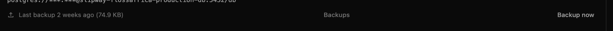
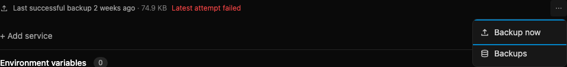

# Scheduled backup registration repair

Quest loads `scripts/*.js` using `include-all`. Its loader catches an import failure around the whole directory and returns an empty registry. `benchmark-bridge-runtime.js` (introduced in `f169ce12`, 2026-08-03) throws on import when no valid container argument is supplied. Several other command-only scripts also execute work during import. Local reproduction at baseline `670d09a5`: **zero jobs**; after separating command tools as `.cjs`: **seven jobs**, including `run-scheduled-backups` every minute with overlap prevention.

Command tools retain their entry points with a `.cjs` extension, following the existing command-script convention. Callers in package scripts, local tooling, tests, CI and docs follow those paths. The scheduled Sails scripts remain in `scripts/`; no new `lib/` directory or scheduling abstraction is introduced.

The schedule is persisted as the `backupSchedule` setting. The backup script checks configured storage, enabled state, interval and last-run watermark before selecting running managed/reachable external services. Existing schedule-update code preserves `lastRunAt`. The repair does not change schedule values or invoke backups.

The environment controller now returns the last completed backup separately from the newest attempt. The row uses the existing Klean horizontal-ellipsis menu for “Backup now” and “Backups” and retains last successful time/size when a newer attempt fails. The invoker shows progress, the backup menu item preserves disabled/busy semantics, and the existing menu handles keyboard navigation, dismissal and positioning. No divider lines were added.

## Visual review

The before image is the user-supplied production crop. After images are synthetic fixtures rendered by the actual environment page, with an older successful backup and a newer failed attempt. They do not establish a production rollout.

| Before                                                        | After, dark desktop                                                           |
| ------------------------------------------------------------- | ----------------------------------------------------------------------------- |
|  |  |

[Light desktop](images/backup-row/menu-light-1280.png) · [Dark mobile](images/backup-row/menu-dark-390.png)

## Affected jobs

The directory-wide failure affects all seven definitions: scheduled database backups (and its cleanup/retention work), deployment interruption recovery and queued dispatch, observability retention and disk checks, Wake retention, abandoned Bridge support grant expiry, release update checks, and system-database snapshot integrity checks. This is verified against the local registry and source; it does not establish which production tasks last ran.

## Read-only production evidence

The existing `~/.slipway/config.json` connection resolved `https://slipway.sailscasts.com`; its authenticated instance-log endpoint identified the container as `slipway`. Only read requests were used; credentials and raw log lines were not copied into evidence.

- Persisted schedule: enabled, interval 24 hours, retention 10; `lastRunAt = 1785516999008` (**2026-07-31 16:56:39.008 UTC**).
- FLOSSAfrica PostgreSQL service 15 is running. Its returned backup history contains three completed **manual** backups and no scheduled backup. Latest returned manual backup: 2026-10-15; the two preceding returned manual backups are from October 1. This is the endpoint’s returned history, not a claim about all historical deleted backups.
- A bounded instance-log snapshot read 271 SSE events. It contained no known scheduler import-error or backup-run markers. Registry loading failures log at verbose level; absence from this snapshot does not prove the running registry state.
- `f169ce12` introduced the throwing Bridge benchmark on 2026-08-03. The production schedule watermark predates that commit, so it must not be represented as proof that this commit alone explains the first missed production run. Other command-only imports existed earlier. The current directory failure is independently reproduced locally.

## Verification

- `node --test tests/unit/scripts/scheduled-backups.test.js`: 5 passed; actual directory registration plus mocked due, disabled, not-due and unavailable-storage behavior.
- Sounding targeted command-path and scheduler tests: 8 passed.
- `node --test tests/contracts/quest-registry-initialization.cjs`: 2 passed.
- Existing mocked manual-backup browser trial: passed.
- New backup-row browser trial: passed, including last success after failure, enabled retry, grouped actions, desktop/mobile overflow and dark/light screenshots.
- Normal CLI invocation: `npm run check:consistency`, `node scripts/rehearse-coolify-migration.cjs --help`, and the synthetic `node scripts/benchmark-migration-catalog.cjs` completed successfully. The Bridge benchmark’s missing-argument usage failure remains intact. Repository search found no stale executable `.js` references to renamed tools.
- Prettier on changed source and command scripts, and `git diff --check`: passed.

Direct live resident-registry inspection is not exposed by the read endpoints used; the production evidence above is deliberately limited. No live database backup, restore, schedule mutation, migration, deployment, merge or release was performed.
