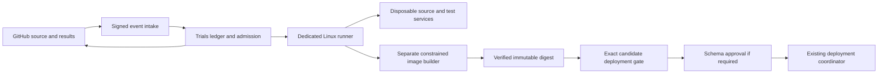
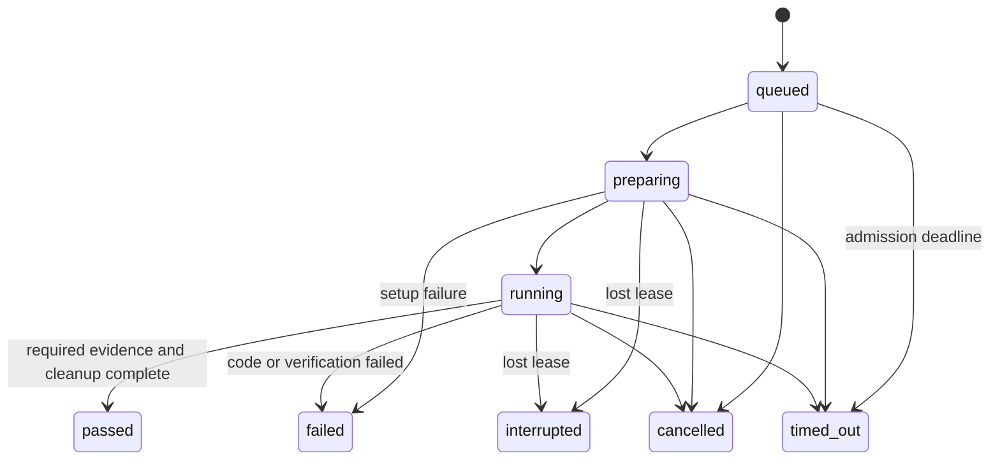

# Signal: native verification in Slipway

Status: proposal and first implementation slice, issue [#853](https://github.com/sailscastshq/slipway/issues/853). The maintainer selected SailsConf as the first pilot. This document does not enable production execution or replace required GitHub checks.

**Push your code. Verify the app. Deploy what passed.**

## Name and product boundary

**Signal** is the proposed product name after the maintainer rejected “Trials.” It answers whether a commit is ready for deployment and fits alongside Helm, Dock and Lookout. Sounding remains the test framework and Quest the scheduler. Use “run,” “checks,” “build,” and “deployment” in the interface, rather than inventing a noun for every action. This is a naming proposal, not a trademark-clearance claim. Internal `trials` source paths remain provisional until the name is settled.

The preview follows the existing AppLayout team selector and neutral palette, QuestRuns density, QuestStatus badges, owned Klean icon geometry and compact action styling. Production integration must compose the actual Vue primitives and AppLayout; this standalone interactive preview does not replace them. The SailsConf owner explicitly selected lint as a required check, followed by tests and build.

Signal can replace an app's supported install/check/build/verify workflows. It does not replace source hosting, code review, branch protection, Dependabot, arbitrary marketplace actions, OS matrices, or every release-publishing workflow. Normal setup needs no YAML. Advanced repository configuration is deferred until it can have one explicit source of truth.

## Existing-system audit

| Existing source                                                                                                | Reuse                                                                                     | Gap to close                                                                                                                                                  |
| -------------------------------------------------------------------------------------------------------------- | ----------------------------------------------------------------------------------------- | ------------------------------------------------------------------------------------------------------------------------------------------------------------- |
| `api/controllers/webhook/github.js`, `api/controllers/api/v1/webhook/github.js`                                | Repository resolution and signed push intake                                              | PR/check re-request events currently ignored; CI must not depend on auto-deploy being enabled.                                                                |
| `api/helpers/git/verify-webhook-signature.js`, `api/lib/with-webhook-delivery.js`                              | Raw Buffer HMAC-SHA256, timing-safe comparison, delivery receipt deduplication            | Atomically commit CI admission and receipt completion; a crash must not strand a delivery as processing forever.                                              |
| `api/models/GitProvider.js`, `api/helpers/git/get-github-oauth-url.js`                                         | Existing provider/repository ownership                                                    | OAuth flow is implemented; App ID/key/installation fields alone do not implement installation-token issuance or grant Checks access.                          |
| `api/models/DeploymentJob.js`, `api/models/DeploymentLease.js`, `api/helpers/deploy/run-queued-deployments.js` | Durable queue, target serialization, lease/heartbeat/fencing patterns                     | This coordinator executes deployment work locally. Arbitrary CI processes must run on a separate runner. Do not reuse deployment leases as runner leases.     |
| `api/lib/instance-quest.js`, `api/hooks/instance-quest/index.js`                                               | Scheduled reconciliation and bounded history; active work becomes interrupted on restart  | Quest can wake admission/reconciliation, not become the CI execution sandbox. Its existing allowlisted maintenance jobs are not arbitrary repository scripts. |
| `api/helpers/deploy/execute-pipeline.js`                                                                       | Existing image build, inspect-by-image-ID, readiness, health, traffic switch and rollback | The pipeline currently builds its candidate. Add explicit verified-digest intake; do not verify one image and rebuild another.                                |
| Schema review/resume [#767](https://github.com/sailscastshq/slipway/issues/767)                                | Preserve a candidate while approval is pending                                            | Bind approval to the verified image and schema intent. A passing Trial never authorizes destructive migration.                                                |
| Klean primitives, existing app layouts and compact status rows                                                 | App-owned visual language, keyboard behavior and reduced motion                           | A dedicated app Trials surface and setup review, not another global dashboard.                                                                                |

### SailsConf baseline

Its checked-in GitHub workflow is one Linux job: checkout, Node 22 with npm cache, `npm ci`, `npm test`, `npm run build`. Tests use Sounding through the existing Node test command. Its test configuration disables external hooks and uses isolated SQLite. PostgreSQL/Redis dependencies are hints about possible services, not permission to import production settings or proof that tests need both.

The local SailsConf checkout contains uncommitted work. Discovery reads `git show FULL_SHA:package.json` and root lockfiles, not the working tree, `.env`, or executable Sails configuration. A later pilot must identify its exact committed revision and preserve those edits. Recent GitHub runs are failing; a valid pilot reproduces and distinguishes those failures rather than quietly dropping checks.

## Research and what can actually be faster

GitHub supports external CI results linked to commits; a GitHub App is the preferred rich Checks integration. A simpler OAuth commit-status integration is also available. We should not assume an existing OAuth secret can create App check runs. Scope the App to repository metadata/contents read, pull requests read, and checks write; subscribe only to push, relevant PR and check re-request events. Installation tokens and webhook secrets stay in the control plane. See [Checks API](https://docs.github.com/en/rest/checks/runs), [GitHub App CI guide](https://docs.github.com/en/apps/creating-github-apps/writing-code-for-a-github-app/building-ci-checks-with-a-github-app), and [commit statuses](https://docs.github.com/en/rest/commits/statuses). Verify token capability during setup; show a setup error rather than an eternally pending check.

Webhook work must be acknowledged promptly and admitted durably. Validate the exact raw bytes before parsing trusted semantics, deduplicate the delivery GUID, reject unsupported actions and repository IDs, and reconcile receipt/run pairs after crashes. [GitHub webhook validation](https://docs.github.com/en/webhooks/using-webhooks/validating-webhook-deliveries) and [delivery practices](https://docs.github.com/en/webhooks/using-webhooks/best-practices-for-using-webhooks) define the signature and delivery-ID behavior.

The speed opportunity is lower queue delay, a warm **trusted base/runtime**, scoped npm download caches, reusable BuildKit layers, fewer redundant installs and one verified artifact through deployment. A clean workspace is still created per run. Never retain a tested app's background processes or writable node_modules between trust domains. SailsConf already has one job and npm caching, so large gains are unproven. Purely moving its same serial test process to a smaller machine may be slower.

BuildKit supports external cache import/export; caches require trust separation and bounded retention. Package cache keys include tenant/repository, platform, architecture, Node/package-manager versions and lock digest. PR caches cannot write the trusted main cache. Build caches are separate from package caches. Cache mounts alone do not survive a fresh builder or get restored by an ordinary exported layer cache. See [Docker cache backends](https://docs.docker.com/build/cache/backends/), [cache optimization](https://docs.docker.com/build/cache/optimize/) and the [Dockerfile cache-mount reference](https://docs.docker.com/reference/dockerfile/). Never put registry credentials in build arguments or image layers.

Use `npm ci` with the committed lockfile; lock disagreement is setup failure, not a reason to regenerate dependencies. Package-manager versions, lifecycle scripts, dev dependencies and native platform matter. See [npm ci](https://docs.npmjs.com/cli/v11/commands/npm-ci/).

Self-hosted CI is not free: CPU/RAM capacity, idle time, storage, egress, maintenance and incident handling remain ours. Standard hosted Actions for public repos are free; private-repository allowances depend on the plan. Therefore no blanket cheaper-than-GitHub claim is justified. See [Actions billing](https://docs.github.com/en/billing/concepts/product-billing/github-actions).

## Control plane, runner and builder

Slipway owns admission, policy, immutable identities, reporting and deployment gating. The runner pulls one job, receives a per-run capability, and executes sequential steps in a disposable sandbox. A worker process is never spawned inside the Slipway web runtime to execute tests. Quest may schedule queue reconciliation and expiry handling.

Use a dedicated Linux VM for the first production runner, separate from app/database hosts. Allow one active job per runner. Containers restrict job privileges within that VM; they are not the entire isolation boundary. Public fork execution stays disabled. GitHub's [compromised-runner guidance](https://docs.github.com/en/actions/concepts/security/compromised-runners) and [secure-use guidance](https://docs.github.com/en/actions/reference/security/secure-use) explain why untrusted code can compromise persistent runner state.

The job receives only source, immutable configuration and generated test-service settings. No production mounts, database files/sidecars, host environment inheritance, cloud metadata endpoint, production credentials or Docker socket. Use a non-root user, dropped capabilities, no-new-privileges, CPU/memory/pid limits, a filesystem quota, step and total deadlines, and bounded stdout/artifacts. Default container resource use is unrestricted unless explicitly limited; [Docker resource constraints](https://docs.docker.com/engine/containers/resource_constraints/) are part of admission, not a best-effort hint.

The runner manager and image builder are privileged boundaries outside job containers. Prefer a dedicated rootless BuildKit worker where supported; do not enable `network.host` or `security.insecure` entitlements or pass builder socket/certificates into jobs. The [BuildKit configuration](https://docs.docker.com/build/buildkit/toml-configuration/) and [Docker security model](https://docs.docker.com/engine/security/) inform this separation. A rootless builder still requires review; its label is not proof of complete isolation.

Runner registration, identity, short-lived credentials, revocation, outbound-only transport, registry scopes and egress policy are a security-review gate **before production implementation**. Do not create credentials or provision a production runner in this first design slice. The local pilot has no registration endpoint and cannot receive webhooks or deploy.

### Proposed network policy

Install/build egress goes through an allowlisted package/source proxy; no production or metadata networks. Tests and candidate services share a per-run isolated network with no public ingress and no external egress by default. Test-only third-party requests use configured fakes. Package credentials, if needed later, are short-lived and scoped to install, not copied into test environments or caches. SQLite paths exist only inside the run workspace; Postgres/Redis versions are pinned and synthetic credentials expire with the run.

## Immutable identity and configuration

A run records repository ID, app ID, exact source SHA, reviewed configuration revision, manifest and lock digests, runtime image digest and observed versions, service image/config fingerprints, command identities, attempt, runner and built image digest. Record PR head and intended merge/deployment SHA separately. A PR green result cannot approve a new merge SHA; enqueue verification for that exact revision. Do not follow a moving branch during checkout, service startup or final reporting.

Configuration is append-only and versioned. The saved version is the source of truth in v1. Discovery is JSON/lockfile inspection only, returning suggestions and script previews, never loading `config/*.js`, lifecycle hooks or package scripts. Owner confirms commands, required flags, Node/package-manager selection, service versions, timeouts and test-only settings. Missing tests display **No tests configured**; health checks cannot be described as passing tests. Do not select `lint:fix`, start/dev, migration or release commands as automatic check suggestions. If a parent test script invokes child lanes, suggest the parent once rather than accidentally running both.

A configuration revision fingerprints canonical execution policy. Changes create a new version; an active run retains its original snapshot. Config secrets require explicit CI-only keys and a vault reference in the fingerprint, never plaintext JSON history. The config's credential identity/revision must invalidate prior deployment approval when changed.

## Proposed durable data model

| Table                  | Fields and constraints                                                                                                                                                                                                                                                          |
| ---------------------- | ------------------------------------------------------------------------------------------------------------------------------------------------------------------------------------------------------------------------------------------------------------------------------- |
| `trial_configurations` | app, revision/content hash, schemaVersion, owner/reviewedAt, immutable commands, required IDs, runtime/service pins, limits, CI-only secret reference versions; unique(app, revision)                                                                                           |
| `trial_runs`           | UUID, app/repository, event/delivery, source SHA, PR/base/merge SHA, config revision, state, attempt/retryOf, identity fingerprint, admitted/deadline/start/finish times, cancelRequestedAt, failureClass, immutable built/verified digest, cleanup state; unique admission key |
| `trial_steps`          | run, ordinal/key, command digest, required, state, exit code, timings, observed runtime, bounded log/artifact receipts; unique(run, ordinal)                                                                                                                                    |
| `trial_runners`        | runner identity, reviewed profile/capabilities, heartbeat, quarantine/availability; no job-visible control-plane token                                                                                                                                                          |
| `trial_runner_leases`  | unique runner ID, run ID, fencing generation/token hash, owner, heartbeat/expiry; one active job per runner                                                                                                                                                                     |
| `trial_events`         | append-only run event sequence, transition/step/log receipt metadata; unique(run, sequence)                                                                                                                                                                                     |
| `trial_outbox`         | GitHub report intent/retry state and admission/report deduplication; atomically committed with state transitions                                                                                                                                                                |

Integrate through reviewed migrations; do not let Sails auto-alter live tables. New tables are not added in the foundation PR. Logs/artifacts live in bounded storage with indexed receipts, not endlessly growing SQLite text fields. Start with 10 MiB logs/run, 100 MiB artifacts/run, seven-day log/artifact retention, thirty-day run summaries, ten queued runs/app and one active run/runner. Treat these as initial configurable limits to validate, not hidden universal constants. Cache eviction and orphan cleanup have separate quotas.

## State machine and recovery

Persist `timed-out` as the explicit domain state; the diagram uses a display-safe alias. Terminal states never move backwards. Retry creates a new run and attempt linked to the previous run. Cancellation requests fence further writes immediately but display “Stopping” until teardown is acknowledged. Superseding a PR requests cancellation; it does not pretend the old process has exited.

Completion uses an atomic compare-and-swap on state, configuration identity and unexpired lease generation. A late or replayed runner completion cannot override cancellation/expiry. Heartbeats happen on the trusted manager, independently of job stdout. On restart, queued work can be re-admitted idempotently; lost active leases become interrupted, never passed. Quarantine unavailable runners and unknown resources until cleanup is confirmed. Do not free capacity solely because a request timed out.

Cleanup runs on success, failure, timeout and cancellation. A cleanup error is visible and blocks deployable verification, rather than silently turning unknown state green. Runner cleanup must target only resources labeled with that run's ID, including services, network, workspace and builder references. Preserve bounded evidence before deletion.

| Failure                                     | User-visible result and recovery                                                                                    |
| ------------------------------------------- | ------------------------------------------------------------------------------------------------------------------- |
| No eligible runner                          | Queued with runner-unavailable explanation and admission deadline; not code failure or success                      |
| Lock/runtime/service mismatch               | Setup failed with the exact item to fix; checks not run                                                             |
| Tests fail or zero tests discovered         | Failed tests or No tests configured; never substitute startup for tests                                             |
| Runner disappears / control plane restarts  | Interrupted with unknown execution outcome, fenced callbacks, cleanup/reconcile before retry                        |
| User cancels / newer commit arrives         | Stopping, then cancelled once cleanup is confirmed; new attempt/source remains separate                             |
| Image/version differs from passed candidate | Deployment blocked with expected/observed identity; no rebuild-as-approval shortcut                                 |
| Schema approval needed                      | Keep the verified image, show review action and resume that digest; tests do not approve migration                  |
| GitHub reporting unavailable                | Persist report intent and retry; show reporting failure separately from code outcome; never fabricate a green check |
| Artifact/cache capacity exhausted           | Bounded failure or cache miss; preserve current production app and report cleanup needs                             |

## Deployment gate

Preparation → source checks → image build → candidate/schema verification → optional schema review → deployment → production health verification.

The gate compares app, repository, SHA, config revision, runtime/service fingerprints and image digest. Check required step evidence, cancellation, confirmed cleanup and release metadata consistency, including both lockfile root version fields. Use the existing inspected artifact when deploying. A deliberately rebuilt image is a new artifact revision even if an existing Git tag stays unchanged. Keep that distinction in the run UI and release audit.

The foundation helper evaluates this contract but is deliberately **not wired into production deployment** until trusted runner evidence and persistence exist. Do not call a pure helper's returned object an implemented security boundary; the admission, authorization, transaction, attestation and immutable-data layers are also required.

## UX and DX

App → Trials shows compact recent runs with commit, branch/PR, status, duration and deployment linkage. Select a run to inspect sequential steps, plain reasons, live log tail and immutable artifact identity. Show retry/cancel only when available. Use a compact status label, not an oversized success banner. Keep keyboard focus visible, tabs semantic, progress announced politely, logs selectable, and motion reduced when requested.

Settings → Trials: discover → review commands/runtime/services → confirm policy → enable shadow runs. Display both script name and actual package-script contents, plus install lifecycle-script implications. Nothing executes on “Discover.” No YAML is required. The details page says clearly whether it is source-only verification, image verification, waiting on schema review, or ready for deployment.

Use existing Klean primitives in production Vue implementation. The first interactive standalone mockup follows the existing typography, restrained light/dark palette and native accessible controls; it is labeled as a design prototype and cannot run a job.

## Phases and acceptance tests

1. **Foundation (this slice):** source audit/research; non-executing discovery; exact-commit CLI; fail-closed identity/state contracts; reviewable UI prototype; SailsConf plan. Verify no scripts run during discovery, conflicting lockfiles block setup, test umbrella selection avoids duplicate required lanes, and no tests is explicit.
2. **Local SailsConf shadow proof:** owner-reviewed same commands, a pinned trusted commit, disposable Linux workspace, no prod env/data, bounded resources/logs and real cleanup. Record actual outcomes, cgroup CPU/memory, timing and limits. A failing baseline remains failed. This is not a production runner or a completed CI replacement.
3. **Durable execution/security review:** schema-reviewed ledger/outbox, atomic leases/fencing, runner registration/revocation, network/credential review, temporary Postgres/Redis/SQLite, clean cache trust scopes. Kill the runner/control plane at every stage; prove interrupted/cancelled/replayed work cannot pass or deploy.
4. **GitHub shadow integration:** exact-SHA check/status reporting with least privilege, signed webhook/re-request handling and report retries. Prove one admission for duplicate delivery and no public forks. Measure at least twenty comparable runs, cold and warm, across passing and failing commits; report raw samples before p50/p95 claims.
5. **Production-app gate and replacement:** verify the built artifact once, preserve schema approval, deploy exactly that digest through existing orchestration. Demonstrate wrong merge SHA/config/runtime/image/version and stale lease are rejected. Explicit approval is required before replacing required GitHub checks. Preserve the old workflow as a rollback until the agreed observation period ends.

A local source-check proof cannot satisfy phase 5. SailsConf is the chosen production-app pilot, not a reason to run tests against its production database or quietly remove branch protection.

## Measurement plan

Record queue, prepare, dependency install, source checks, image build, candidate health/schema, cleanup and reporting durations separately. Record CPU seconds, peak memory, workspace/cache/artifact bytes, bandwidth where available, runner uptime/idle time and retry/interruption rates. Cache keys and hardware profiles must accompany timing comparisons. Compare the same commit/checks on equivalent resources; do not call an incomplete run faster.

Monthly cost = reserved runner time × actual hourly rate + storage + egress + operations effort. Cost/run must include idle capacity divided across successful **and failed** attempts. Local Docker measurements do not establish production-host cost or a GitHub speedup. Include at least one intentionally failing check, lock mismatch, cancellation and runner-loss recovery in pilot evidence. Only then decide whether warm capacity is worth its idle bill.

## Local pilot evidence, 24 October 2026

These are isolated local Linux ARM64 source checks, not a deployed runner or a deployment approval. Production configuration and existing GitHub checks were unchanged.

- Original SailsConf source `31648c0de84a011196364d50cadc97dd3d24e660`: install passed; tests found an explicit-column mapping failure. Build did not run.
- Minimal repair `8ac88f53b68037fa7e0fb08e27c17aea402da78f`: install, tests and assets build passed in 271.93 seconds, cold. The test result was 312 passed, one skipped. Peak container memory was 1,362,702,336 bytes, CPU consumption 162.007412 seconds. This policy did not include lint.
- Owner-required policy `lint → test → build` on that same repair: install passed in 71.74 seconds; lint failed in 11.16 seconds with 32 formatting violations. Tests and build did not run in this attempt. Total time was 84.5 seconds; cleanup was confirmed. This policy is **failed**, regardless of the earlier green baseline. No checks were weakened and no production deployment was started.

The app repair is separately reviewable in private SailsConf PR #314. Broad formatting cleanup must remain distinguishable from the three explicit column mappings. The preview uses illustrative data, explicitly labeled; it does not display these results as a verified application image. No GitHub speed comparison is available because the baseline job did not execute.
